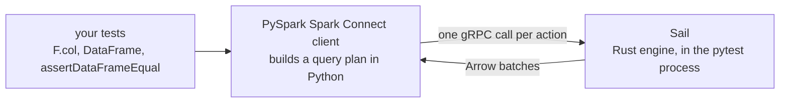

<h1 align="center">sparkwarp</h1>

<p align="center">
  <b>Run your existing PySpark tests in milliseconds. No JVM, no test rewrites.</b>
</p>

<p align="center">
  <a href="https://github.com/hugoespinelli/sparkwarp/actions/workflows/ci.yml"></a>
  
  
  
  
</p>

<p align="center">
  <picture>
    <source media="(prefers-color-scheme: dark)" srcset="https://raw.githubusercontent.com/hugoespinelli/sparkwarp/main/docs/assets/benchmark-suite-dark.svg">
    
  </picture>
</p>
<p align="center"><i>The same 42 lakehouse-style tests, same code, same conftest. Only <code>SPARKWARP=1</code> differs.</i></p>

- **Fast.** About 25 ms per test instead of about 360 ms. The JVM, Py4J and the Spark
  scheduler drop out of the loop.
- **Zero edits.** Your `SparkSession.builder...getOrCreate()` conftest, your `F.*` calls and
  your `assertDataFrameEqual` stay as they are. You set one environment variable.
- **Honest about differences.** A corpus of 329 cases, recorded on real Spark, checks the
  engine. Every known difference is a test and is listed in [`KNOWN_GAPS.md`](https://github.com/hugoespinelli/sparkwarp/blob/main/KNOWN_GAPS.md).
- **Real Spark stays one switch away.** `SPARKWARP=0` runs the same suite on the JVM, so
  CI keeps a parity lane.

## Why sparkwarp exists

PySpark tests are slow even when the data is tiny. Each action, such as `count()` or
`collect()`, pays a fixed cost before any data moves. Python calls the JVM through Py4J,
Catalyst plans the query, and the scheduler builds stages and tasks as if for a cluster.
On a laptop that costs 300 to 400 ms per action, whether the DataFrame has 4 rows or
4 billion. Config tuning (`local[1]`, UI off, codegen off) makes execution cheaper, but
the fixed cost stays.

Teams then wait. A suite of a few thousand Spark tests takes 15 to 30 minutes, so developers run
only part of it, and regressions reach the pull request late. At the medians above,
2,000 tests would take about 12 minutes on local Spark and under a minute on sparkwarp.
That is an estimate from the benchmark, not a measurement of your suite.

sparkwarp makes the inner loop fast without asking you to rewrite tests against a new API.
It keeps PySpark and swaps only the engine underneath. Use it for unit tests on small data.
Production keeps running on Spark.

## Installation

Install the 0.1.0 release from GitHub:

```bash
pip install https://github.com/hugoespinelli/sparkwarp/releases/download/v0.1.0/sparkwarp-0.1.0-py3-none-any.whl
```

Or from source:

```bash
git clone https://github.com/hugoespinelli/sparkwarp.git && cd sparkwarp
pip install .
```

`pip install sparkwarp` from PyPI is coming next.

Requirements: Python 3.10+, PySpark 4 (installed as `pyspark[connect]>=4`), pytest 8+.
No Java is needed. sparkwarp does nothing until you switch it on, so installing it does
not change how your suite runs.

## Usage

### Your conftest already builds a session

Change nothing in the code. Run:

```bash
SPARKWARP=1 pytest
```

A conftest like this one now gets a session on Sail:

```python
@pytest.fixture(scope="session")
def spark():
    session = SparkSession.builder.master("local[1]").appName("tests").getOrCreate()
    yield session
    session.stop()
```

sparkwarp drops the `master` setting for you, because PySpark refuses a master URL in
Spark Connect mode. `unittest` classes that build the session in `setUpClass` work the
same way.

### You have no session fixture yet

Use the one that the plugin provides:

```python
def test_filter(spark):
    df = spark.createDataFrame([(1, "a"), (2, "b")], "id int, name string")
    assert df.filter("id > 1").count() == 1
```

```bash
pytest --sparkwarp
```

The `spark` fixture is function-scoped, so every test gets the live session, even if older
code stopped it. A session-scoped fixture of your own should build its session with
`SparkSession.builder...getOrCreate()` instead of requesting `spark`.

### Keep a parity lane on real Spark

```bash
SPARKWARP=0 pytest      # or plain `pytest`: your own fixture, on the JVM
```

Run this lane in CI, nightly or on merge. It is the guard against the few gaps that change
results without an error (see [How faithful is it](#how-faithful-is-it)).

### Tests that need real Spark

```python
@pytest.mark.spark_only
def test_reads_through_the_rdd_api(spark):
    ...
```

`spark_only` works on a test, a class or a module (`pytestmark`). sparkwarp skips those
tests on Sail and gives the reason (shown with `pytest -rs`). They run when sparkwarp is
off. When a test fails because Spark Connect or Sail does not support a feature, such as
`df.rdd` or `spark.sparkContext`, the failure report gets a short sparkwarp section that
says so.

### Outside pytest

```python
import sparkwarp

spark = sparkwarp.session()          # Sail, ANSI on, timezone UTC
spark.range(3).count()
sparkwarp.stop()                     # optional; it also runs at exit
```

### Switches

| Switch | Effect |
|---|---|
| `SPARKWARP=1` | Run on Sail |
| `pytest --sparkwarp` | Run on Sail; wins over `SPARKWARP=0` |
| `SPARKWARP=0` or unset | Off: your own fixture, on real Spark |

On Sail the session uses Spark 4 semantics with ANSI mode on and session timezone UTC. A
timezone that you set on your builder or with `spark.conf.set` wins. A test that starts a
subprocess should pass `env=sparkwarp.clean_environ()`, because the child does not inherit
sparkwarp's routing.

## How it works



PySpark 4 ships a [Spark Connect](https://spark.apache.org/docs/latest/spark-connect-overview.html)
client. With it, `F.col`, `DataFrame` and `Window` build a query plan in plain Python, and
only an action sends that plan to a server, in one call. sparkwarp starts
[Sail](https://github.com/lakehq/sail), a Spark Connect server written in Rust, inside the
pytest process. It then points PySpark at Sail with two environment variables and a small
patch to `SparkSession.Builder`. Your tests keep calling the real PySpark API, so there is
no second API to keep in sync with Spark.

## Benchmarks

<p align="center">
  <picture>
    <source media="(prefers-color-scheme: dark)" srcset="https://raw.githubusercontent.com/hugoespinelli/sparkwarp/main/docs/assets/benchmark-per-test-dark.svg">
    
  </picture>
</p>

| Engine | Suite wall time | Median per test | p90 per test |
|---|---|---|---|
| Real Spark, `local[1]`, tuned | 31.7 s | 364 ms | 686 ms |
| sparkwarp (Sail) | 2.8 s | 25 ms | 34 ms |

The suite in [`benchmarks/`](https://github.com/hugoespinelli/sparkwarp/tree/main/benchmarks) is 42 tests shaped like a real lakehouse repo.
They are transformer classes with a `process(df)` method, tested with `createDataFrame`,
`F.*`, `Window`, `groupBy().agg()`, joins, `unionByName`, `from_json`, `explode`,
`regexp_replace`, `date_trunc`, `spark.sql()` on temp views and `assertDataFrameEqual`.
Both rows use the same test bodies and the same conftest.

Method: median of 3 runs, one pytest process per engine, on Linux x86_64 with 16 CPUs,
Python 3.11, PySpark 4.2.0 and pysail 0.7.2. The Spark side already uses every setting the
guides recommend: `local[1]`, UI off, adaptive execution off, one shuffle partition,
whole-stage codegen off. The slowest test on each engine is the first one, which starts the
session: about 12 s on Spark, mostly JVM start, and about 150 ms on Sail.

Reproduce it (Java 17+ is needed only for the Spark side):

```bash
uv sync --extra test --group dev
uv run python -m benchmarks.run --runs 3 --java-home /path/to/jdk17
uv run python -m benchmarks.chart        # redraws the charts in docs/assets
```

## How faithful is it?

A corpus of 329 cases checks Sail against real Spark. It covers ten semantic traps (null
logic, coercion, ANSI casts, arbitrary rows from deduplication, window frames, Java regex,
timestamps, schema, joins and SQL), the `F.*` functions that lakehouse code uses, the
DataFrame methods and actions, and row order. Real Spark recorded every expected result,
and CI checks them again on both engines.

| Area | Cases | Match Spark on Sail |
|---|---|---|
| Functions | 170 | 165 |
| DataFrame methods and actions | 59 | 54 |
| Semantic traps | 88 | 74 |
| Row order | 12 | 8 |

Matches are compared the way `assertDataFrameEqual` compares by default. Every difference
is a test, listed with its severity in [`KNOWN_GAPS.md`](https://github.com/hugoespinelli/sparkwarp/blob/main/KNOWN_GAPS.md). The full table,
case by case, is [`docs/SUPPORT.md`](https://github.com/hugoespinelli/sparkwarp/blob/main/docs/SUPPORT.md). Five gaps change results without
an error: four value gaps plus row order. That is why the parity lane matters.

## Limitations

- PySpark 4 and Spark 4 semantics with ANSI mode on. Spark 3.5 legacy behaviour is out of
  scope.
- No `df.rdd`, no `spark.sparkContext`, no streaming, no `DeltaTable` Python API. Mark such
  tests `spark_only`.
- `isinstance(spark, pyspark.sql.SparkSession)` is `False` under Spark Connect.
- Meant for unit tests on small inputs, not for benchmarking production jobs.

The [FAQ](https://github.com/hugoespinelli/sparkwarp/blob/main/docs/FAQ.md) covers why sparkwarp uses Sail and not sqlframe, Sparkless or
pysparkling, and what to do about each gap.

## Contributing

Contributions are welcome, and the most useful one is a new corpus case. Each case is one
line of Python. If it shows a difference between Sail and Spark, the project learns
something, and so do other users. Bug reports with a minimal repro, docs fixes and upstream
reports to Sail help too.

[`CONTRIBUTING.md`](https://github.com/hugoespinelli/sparkwarp/blob/main/CONTRIBUTING.md) has the development setup, how to add a corpus case,
how to record goldens on real Spark, and the checks every pull request must pass.

## Acknowledgements

sparkwarp is a thin layer. The engine is [Sail](https://github.com/lakehq/sail) by
LakeSail, and the API is Apache Spark's own
[Spark Connect](https://spark.apache.org/docs/latest/spark-connect-overview.html) client.
The test-suite shape came from the many teams who run thousands of PySpark tests every day.

## License

[Apache-2.0](https://github.com/hugoespinelli/sparkwarp/blob/main/LICENSE).
